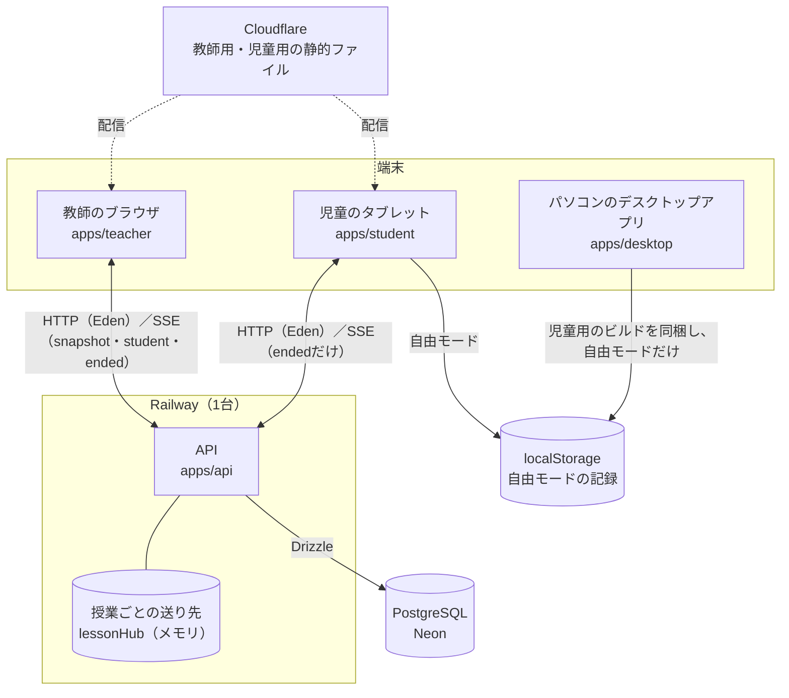
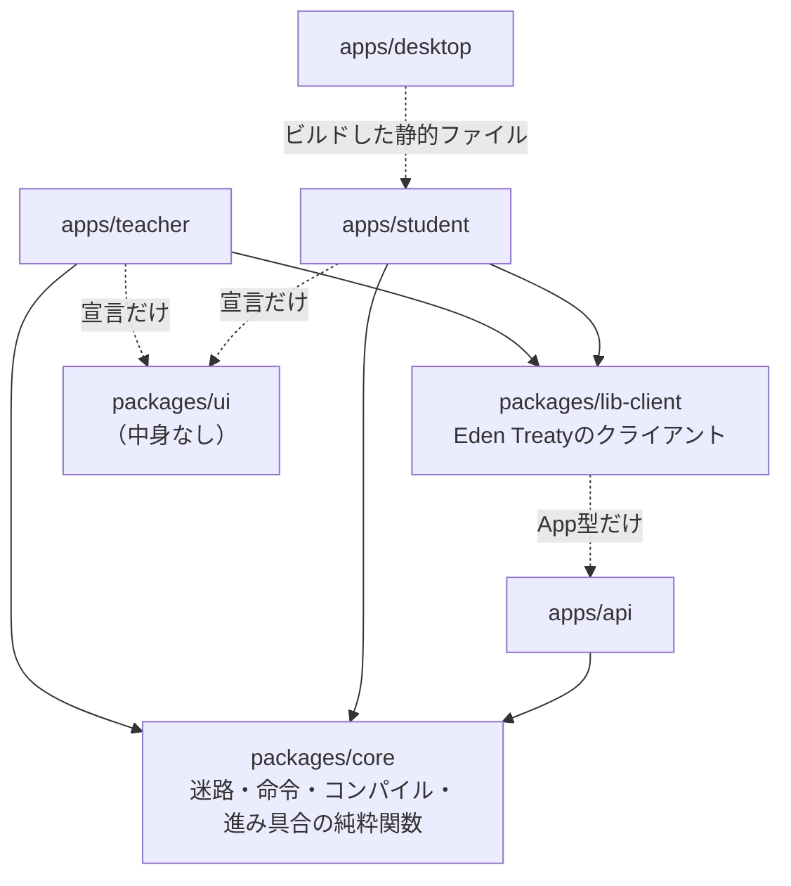
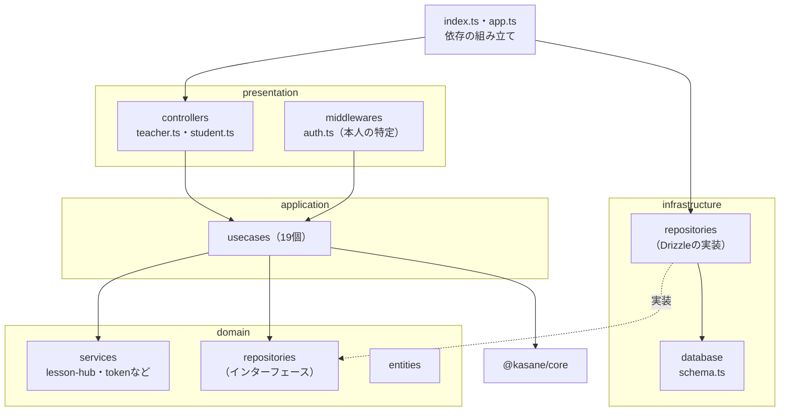
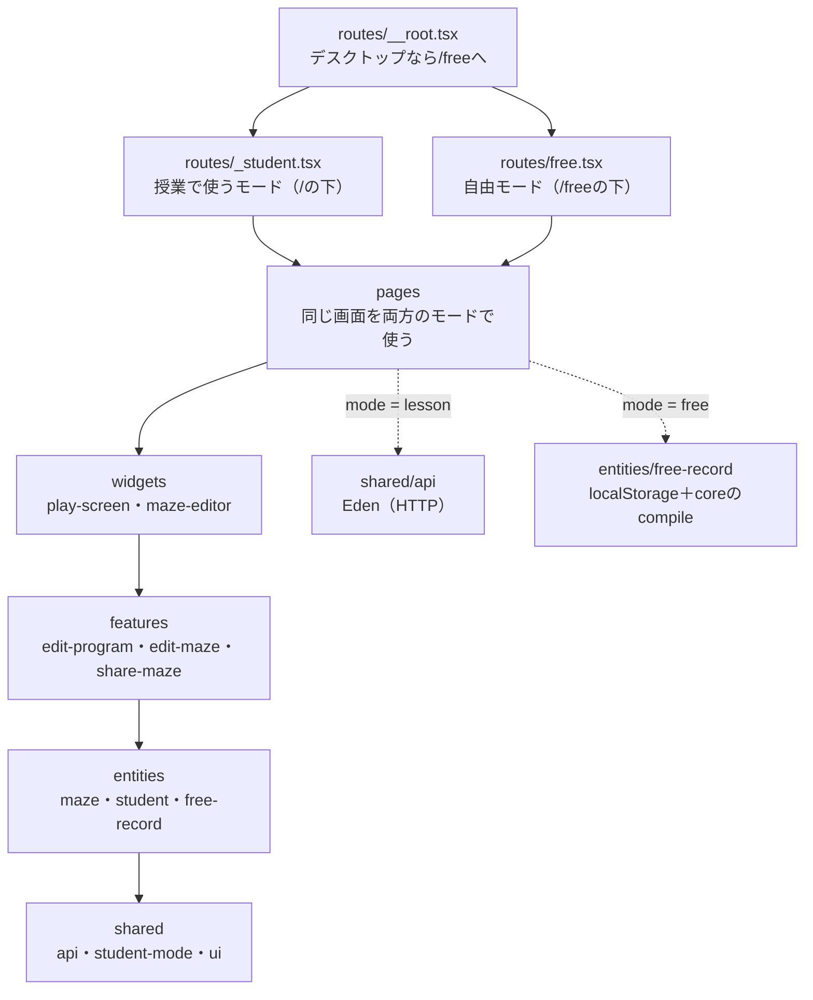
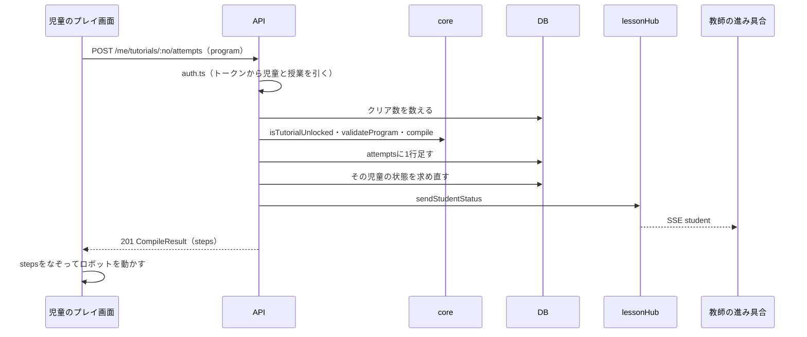

# コードを読む地図

ユースケースごとに、処理が進む順に手順を並べ、手順ごとに読むファイルを添えた地図です。
1日に一つのユースケースを読み、読み終えたら設計ドキュメントにまとめます。まとめ終えたら、このファイルは消します。

- **読み方**
  - 各ユースケースは、処理が進む順に番号を振った手順で、手順ごとに読むファイルを括弧に書く
  - 同じファイルの別の部分を読むときは、見る関数やエンドポイントを「の」の後に書く（「`teacher.ts`の`POST /lessons`」など）
  - 別の節で詳しく読むファイルは、リンクを付けずに節と名前だけを書く（「C2の`notify-student-status.ts`」など）
  - 「新しく読む行数」は、それより前の節で出てきたファイルを除いた行数（テストは含めない）
  - 1,000行を超える節は、手順の前半と後半の2日に分けて読む
  - テストは全部は読まず、仕様を確かめたいときに「E2E」のファイルを開く
  - 仕様書はdevelopから消したので、「仕様」のリンクは`main`の仕様書を開く
  - 地図に載せていないのは、公開APIの`index.ts`・自由モードのルート（`routes/free/`。`_student/`の下と同じ形）・テーマ（`theme.ts`）・数行の共通UIなどで、合わせて約410行
- **読む順番**
  - 全体の構成 → 共通の仕組み（C1〜C4）
  - 授業の1コマの流れ: T1 → T2 → S2 → S3 → S6 → S7 → T4 → T5 → S12
  - 残り: S4 → S5 → S8 → S9 → S10 → S11 → T3 → S1 → F1 → F2 → F3

## 全体の構成

### システム構成

- **状態を変える操作はすべてHTTPで、サーバーからの知らせだけがSSE**
  - 教師は児童の状態（`snapshot`・`student`）と授業の終わり（`ended`）を受け取る
  - 児童は授業の終わり（`ended`）だけを受け取る
- **SSEの送り先はAPIのメモリにあるので、APIは1台で動かす**
- **自由モードはAPIとつながず、コンパイルも記録も端末の中で行う**

### パッケージの依存

- **APIの型（`App`）を`lib-client`経由でフロントエンドが使う**
  - パスや本文の型がずれると、フロントエンドの型検査で止まる
- **`compile`などの判断は`core`にあり、APIと児童アプリ（自由モード）の両方が呼ぶ**
  - 教師アプリが`core`から使うのは`TUTORIALS`だけ

### APIの層（Clean Architecture）

### 児童アプリの層（Feature-Sliced Design）と二つのモード

- **レイアウトが`StudentModeProvider`でモードを渡し、記録の読み書き先と移り先だけを切り替える**

### 中心の流れ（児童がプログラムを送ってから、教師の画面が変わるまで）

## 共通の仕組み

### C1：本人の特定（トークン）

仕様: [backend.md](https://github.com/katsudon08/kasane/blob/main/docs/specs/single/backend.md)「トークン」「アクセス制御」

#### 教師

ログインはなく、端末に保存したトークンで見分けます。

1. 教師の画面がAPIを呼ぶとき、端末にトークンがなければ`POST /teachers`で発行してもらい、localStorageに保存する（[teacher-token.ts](../apps/teacher/src/shared/api/teacher-token.ts)）
2. APIが乱数のトークンを作り、SHA-256にしたハッシュだけを`teachers`に保存して、トークンを返す（[register-teacher.ts](../apps/api/src/application/usecases/register-teacher.ts)、[token.ts](../apps/api/src/domain/services/token.ts)、[teacher-repository.ts](../apps/api/src/infrastructure/repositories/teacher-repository.ts)）
3. 画面は以降の呼び出しに`Authorization: Bearer {トークン}`を付ける（[teacher-token.ts](../apps/teacher/src/shared/api/teacher-token.ts)の`withTeacherToken`）
4. APIのmacroがヘッダーからトークンを取り出し、ハッシュにして教師を引き、`teacherId`をハンドラに渡す（[auth.ts](../apps/api/src/presentation/middlewares/auth.ts)、[identify-teacher.ts](../apps/api/src/application/usecases/identify-teacher.ts)、[identity-repository.ts](../apps/api/src/infrastructure/repositories/identity-repository.ts)）
5. 当たらなければ401を返し、画面はトークンを消して一度だけ発行し直す（[teacher-token.ts](../apps/teacher/src/shared/api/teacher-token.ts)）

#### 児童

トークンは授業に参加したときに受け取ります（S2）。

1. 児童の画面がAPIを呼ぶとき、保存したトークンを付ける（[student-token.ts](../apps/student/src/shared/api/student-token.ts)の`withStudentToken`）
2. APIのmacroがトークンから児童と授業を引き、当たらなければ401、授業が終わっていれば410を返す（[auth.ts](../apps/api/src/presentation/middlewares/auth.ts)、[identify-student.ts](../apps/api/src/application/usecases/identify-student.ts)、[identity-repository.ts](../apps/api/src/infrastructure/repositories/identity-repository.ts)）
3. 画面は401・410を受けたらトークンを消し、`StudentAccessLost`を投げる（[student-token.ts](../apps/student/src/shared/api/student-token.ts)）
4. TanStack Queryがその例外を受け、401なら`/join`へ、410なら`/ended`へ移す（[main.tsx（児童）](../apps/student/src/main.tsx)）

新しく読む行数: 約360行

### C2：サーバーからの知らせ（SSE）と再接続

仕様: [backend.md](https://github.com/katsudon08/kasane/blob/main/docs/specs/single/backend.md)「全体の流れ」「サーバーからの知らせ（SSE）」「再接続」

1. 画面が受け取り口（教師は`GET /lessons/:lessonId/events`、児童は`GET /me/events`）につなぐ
   - 画面側はT2とS12で、つなぐユースケースもT2とS12で読む
2. ユースケースが、先に授業ごとの送り先に登録してから、授業が終わっていないかを読み直す（[lesson-hub.ts](../apps/api/src/domain/services/lesson-hub.ts)）
   - 教師用と児童用の送り先を分けて持ち、児童用には児童の状態を送らない
3. 送り先に届いた知らせを流し、それとは別に5秒ごとにpingを流して、そのたびに授業の終わりを確かめる（[relay-lesson-events.ts](../apps/api/src/domain/services/relay-lesson-events.ts)、[server-event.ts](../apps/api/src/domain/entities/server-event.ts)）
   - 間隔はC3の`app.ts`の`PING_INTERVAL_MS`
4. 流す知らせを1件ずつSSEの形にして送る（[sse.ts](../apps/api/src/presentation/sse.ts)）
5. 児童の状態が変わったら、その授業を開いている教師がいるときだけ、状態をDBから求め直して送る（[notify-student-status.ts](../apps/api/src/application/usecases/notify-student-status.ts)）
6. 授業が終わったら`ended`を流して接続を閉じ、送り先から外す（[relay-lesson-events.ts](../apps/api/src/domain/services/relay-lesson-events.ts)、[lesson-hub.ts](../apps/api/src/domain/services/lesson-hub.ts)）
7. 画面は20秒なにも届かなければ切れたとみなし、少し待ってから、画面が見えていてネットにつながるのを待ってつなぎ直す（[reconnect.ts](../packages/lib-client/src/reconnect/reconnect.ts)、[wait.ts](../packages/lib-client/src/reconnect/wait.ts)）

新しく読む行数: 約270行

### C3：APIの組み立てと、1回のリクエストの通り道

仕様: [backend.md](https://github.com/katsudon08/kasane/blob/main/docs/specs/single/backend.md)「データモデル」「エラーの応答」「入力の上限」

1. 起動すると環境変数を読み、DBにつなぎ、組み立てたアプリを立ち上げて`App`型を書き出す（[index.ts](../apps/api/src/index.ts)、[env.ts](../apps/api/src/config/env.ts)、[drizzle.ts](../apps/api/src/infrastructure/database/drizzle.ts)）
   - 表を作り変えるのは[migrate-database.ts](../apps/api/src/infrastructure/database/migrate-database.ts)
2. リポジトリ → ユースケース → コントローラーの順に作り、依存を渡して組み立てる（[app.ts](../apps/api/src/app.ts)）
3. リクエストが来ると、CORSで教師用と児童用のオリジンだけを通し、16KBを超える本文は読まずに413で返す（[app.ts](../apps/api/src/app.ts)）
4. 本文とパスをTypeBoxで検証し、落ちたら422を返す（[schemas.ts](../apps/api/src/presentation/schemas.ts)、[error-handler.ts](../apps/api/src/presentation/middlewares/error-handler.ts)）
5. `teacher: true`・`student: true`の付いた口では、macroが本人を特定する（C1の`auth.ts`）
6. ハンドラがユースケースを呼び、想定内の失敗は`{ ok: false, reason }`で受け取って、reasonをHTTPのステータスに変える（[failure.ts（domain）](../apps/api/src/domain/entities/failure.ts)、[failure.ts（presentation）](../apps/api/src/presentation/failure.ts)）
7. ユースケースはリポジトリを通して、teachers・lessons・students・mazes・attemptsの5表を読み書きする（[schema.ts](../apps/api/src/infrastructure/database/schema.ts)）
8. フロントエンドは`App`型からEden Treatyのクライアントを作り、型の付いた関数としてAPIを呼ぶ（[lib-client/index.ts](../packages/lib-client/src/index.ts)）

新しく読む行数: 約570行

### C4：児童アプリの二つのモードの切り替え

仕様: [free-mode.md](https://github.com/katsudon08/kasane/blob/main/docs/specs/single/free-mode.md)「画面遷移」

1. 起動するとRouterとQueryClientを用意する（C1の`main.tsx（児童）`）
2. どの画面を開いても、デスクトップアプリなら`/free`の外へは行かせない（[\_\_root.tsx](../apps/student/src/app/routes/__root.tsx)）
3. `/free`の下では、自由モードのレイアウトが下の画面に`mode="free"`を渡す（[free.tsx](../apps/student/src/app/routes/free.tsx)）
4. それ以外の授業の画面では、授業で使うモードのレイアウトがトークンを確かめ、SSEにつなぎ、`mode="lesson"`を渡す（[\_student.tsx](../apps/student/src/app/routes/_student.tsx)）
   - トークンがなければ入口（`/start`）へ移る
5. 画面はモードを受け取り、移り先をモードに合わせて選ぶ（[student-mode.tsx](../apps/student/src/shared/lib/student-mode/student-mode.tsx)、[paths.ts](../apps/student/src/shared/lib/student-mode/paths.ts)）
6. 記録を読み書きする関数は、自由モードならlocalStorage、授業で使うモードならAPIを使う（F1で読む）
7. 描画中に例外が起きたら、どちらのレイアウトでも受け止めの画面を出す（[ErrorPage.tsx（児童）](../apps/student/src/pages/error/ui/ErrorPage.tsx)）

新しく読む行数: 約200行

## 教師のユースケース

### T1：授業を始める

仕様: [README.md](https://github.com/katsudon08/kasane/blob/main/docs/specs/single/README.md)「教師の画面」のホーム ／ E2E: [main-flow.spec.ts](../e2e/main-flow.spec.ts)

1. 教師アプリが起動し、RouterとQueryClientを用意してホーム（`/`）を開く（[main.tsx（教師）](../apps/teacher/src/main.tsx)、[index.tsx](../apps/teacher/src/app/routes/index.tsx)、[ErrorPage.tsx（教師）](../apps/teacher/src/pages/error/ui/ErrorPage.tsx)）
2. 教師がホームの「授業を始める」を押す（[HomePage.tsx（教師）](../apps/teacher/src/pages/home/ui/HomePage.tsx)）
3. 画面が教師のトークンを付けて`POST /lessons`を呼ぶ（[lesson-api.ts](../apps/teacher/src/entities/lesson/api/lesson-api.ts)の`createLesson`）
4. コントローラーが、本人を特定した教師のIDで授業を作るユースケースを呼ぶ（[teacher.ts](../apps/api/src/presentation/controllers/teacher.ts)の`POST /lessons`）
5. ユースケースが、終わる時刻を作ってから5時間後にして授業を作る（[create-lesson.ts](../apps/api/src/application/usecases/create-lesson.ts)、[lesson.ts（core）](../packages/core/src/lesson.ts)）
   - 授業の型とリポジトリの約束は[lesson.ts（entities）](../apps/api/src/domain/entities/lesson.ts)と[lesson-repository.ts（interface）](../apps/api/src/domain/repositories/lesson-repository.ts)
6. リポジトリが`lessons`に1行足し、授業のIDを返す（[lesson-repository.ts](../apps/api/src/infrastructure/repositories/lesson-repository.ts)の`create`）
7. 画面が開いている授業の一覧を取り直すよう指示し、QRコードを見せる画面へ移る（[HomePage.tsx（教師）](../apps/teacher/src/pages/home/ui/HomePage.tsx)） → T2

新しく読む行数: 約440行

### T2：授業QRを見せて、参加した人数を数える

仕様: [README.md](https://github.com/katsudon08/kasane/blob/main/docs/specs/single/README.md)「QRコードを見せる」

1. `/lessons/$lessonId/invite`を開くと、URLの値が授業のIDの形かを確かめる（[invite.tsx](../apps/teacher/src/app/routes/lessons/$lessonId/invite.tsx)、[is-lesson-id.ts](../apps/teacher/src/entities/lesson/lib/is-lesson-id.ts)）
2. 画面が`{児童用のオリジン}/join?lesson={授業のID}`のQRコードを画面いっぱいに出す（[LessonInvitePage.tsx](../apps/teacher/src/pages/lesson-invite/ui/LessonInvitePage.tsx)、[QRCode.tsx](../apps/teacher/src/shared/ui/qrcode/QRCode.tsx)）
   - QRの中身は画面で作り、APIは呼ばない
3. 同時に教師用のSSEにつなぎ、切れたらつなぎ直す（[use-lesson-events.ts](../apps/teacher/src/entities/lesson/model/use-lesson-events.ts)、[watch-lesson.ts](../apps/teacher/src/entities/lesson/model/watch-lesson.ts)）
4. APIが本人の授業かを確かめ、送り先に登録してから、全児童の状態を`snapshot`で送る（[teacher.ts](../apps/api/src/presentation/controllers/teacher.ts)の`GET /lessons/:lessonId/events`、[watch-lesson-as-teacher.ts](../apps/api/src/application/usecases/watch-lesson-as-teacher.ts)、[student-repository.ts](../apps/api/src/infrastructure/repositories/student-repository.ts)の`findStatusesByLesson`）
   - 状態の求め方はT4で読む
5. 児童が参加するたびに`student`が届き、画面は児童のMapを作り直して人数を数える（[apply-lesson-event.ts](../apps/teacher/src/entities/lesson/lib/apply-lesson-event.ts)、[types.ts](../apps/teacher/src/entities/lesson/model/types.ts)）
6. 「進み具合を見る」で進み具合の画面へ移る → T4

新しく読む行数: 約490行

### T3：開いている授業を選ぶ

仕様: [README.md](https://github.com/katsudon08/kasane/blob/main/docs/specs/single/README.md)「教師の画面」のホーム

1. ホームを開くと、開いている授業の一覧を取りに行く（[HomePage.tsx（教師）](../apps/teacher/src/pages/home/ui/HomePage.tsx)、[lesson-api.ts](../apps/teacher/src/entities/lesson/api/lesson-api.ts)の`lessonQueries.open`）
2. APIが、その教師のまだ終わっていない授業を、参加した児童の数と一緒に新しい順で返す（[teacher.ts](../apps/api/src/presentation/controllers/teacher.ts)の`GET /lessons`、[list-open-lessons.ts](../apps/api/src/application/usecases/list-open-lessons.ts)、[lesson-repository.ts](../apps/api/src/infrastructure/repositories/lesson-repository.ts)の`findOpenByTeacher`）
3. 画面が「11月6日10:40に始めた授業」の形で並べ、押すと進み具合へ移る（[lesson-title.ts](../apps/teacher/src/entities/lesson/lib/lesson-title.ts)） → T4

新しく読む行数: 21行

### T4：児童の進み具合を見る

仕様: [README.md](https://github.com/katsudon08/kasane/blob/main/docs/specs/single/README.md)「進み具合」、[backend.md](https://github.com/katsudon08/kasane/blob/main/docs/specs/single/backend.md)「教師に見せる状態の求め方」

1. `/lessons/$lessonId`を開くと、URLの値が授業のIDの形かを確かめて進み具合の画面を出す（[index.tsx](../apps/teacher/src/app/routes/lessons/$lessonId/index.tsx)、[LessonProgressPage.tsx](../apps/teacher/src/pages/lesson-progress/ui/LessonProgressPage.tsx)）
2. 見出しのために授業を始めた時刻を取りに行き、他人の授業・終わった授業なら「この授業は終わっています」を出す（[lesson-api.ts](../apps/teacher/src/entities/lesson/api/lesson-api.ts)の`lessonQueries.detail`、[teacher.ts](../apps/api/src/presentation/controllers/teacher.ts)の`GET /lessons/:lessonId`、[get-lesson.ts](../apps/api/src/application/usecases/get-lesson.ts)）
3. T2と同じ教師用のSSEにつなぎ、`snapshot`と`student`で児童のMapを持つ（[LessonProgressPage.tsx](../apps/teacher/src/pages/lesson-progress/ui/LessonProgressPage.tsx)）
4. APIは、児童ごとのクリア数・今の問題・今の問題の結果を1回のSQLで求める（[student-status.ts](../apps/api/src/domain/entities/student-status.ts)、[student-repository.ts](../apps/api/src/infrastructure/repositories/student-repository.ts)の`findStatuses`、[attempt-repository.ts](../apps/api/src/infrastructure/repositories/attempt-repository.ts)の`clearedCountOf`）
   - クリア数は保存せず、飛ばした問題の数と成功した記録から数える
5. 画面が児童を参加順にカードで並べ、「チュートリアル3/7」と進捗バー、今の問題の結果を出す（[StudentCard.tsx](../apps/teacher/src/pages/lesson-progress/ui/StudentCard.tsx)、[tutorial-progress.ts](../apps/teacher/src/entities/lesson/lib/tutorial-progress.ts)）
6. 5秒以上つながらないときだけ、切れていることを帯で知らせる（[DisconnectedBanner.tsx](../apps/teacher/src/entities/lesson/ui/DisconnectedBanner.tsx)）

状態が変わるきっかけは、児童の参加（S2）・プログラムの送信（S7）・問題を飛ばす（S4）の三つで、どれもC2の`notify-student-status.ts`を呼ぶ。

新しく読む行数: 約340行

### T5：授業を終える

仕様: [README.md](https://github.com/katsudon08/kasane/blob/main/docs/specs/single/README.md)「進み具合」、[domain.md](https://github.com/katsudon08/kasane/blob/main/docs/specs/single/domain.md)「授業の終わり」 ／ E2E: [ended-lesson.spec.ts](../e2e/ended-lesson.spec.ts)

1. 進み具合の「授業を終える」を押すと、確認のモーダルを出す（[LessonProgressPage.tsx](../apps/teacher/src/pages/lesson-progress/ui/LessonProgressPage.tsx)、[Modal.tsx](../apps/teacher/src/shared/ui/modal/Modal.tsx)）
2. モーダルの「授業を終える」を押すと`POST /lessons/:lessonId/close`を呼ぶ（[lesson-api.ts](../apps/teacher/src/entities/lesson/api/lesson-api.ts)の`closeLesson`）
3. APIが本人の授業かを確かめ、終わる時刻を今にして、その授業の教師と児童の全員に`ended`を送る（[teacher.ts](../apps/api/src/presentation/controllers/teacher.ts)の`POST /lessons/:lessonId/close`、[close-lesson.ts](../apps/api/src/application/usecases/close-lesson.ts)）
   - 送るのはC2の`lesson-hub.ts`の`sendEnded`
4. 押した画面は204を受けたら、キャッシュからその授業を消してホームへ戻る（[LessonProgressPage.tsx](../apps/teacher/src/pages/lesson-progress/ui/LessonProgressPage.tsx)）
5. ほかのタブで開いていた教師の画面は、`ended`を受けて「この授業は終わっています」を出す（[LessonEndedNotice.tsx](../apps/teacher/src/entities/lesson/ui/LessonEndedNotice.tsx)）
6. 児童の端末は、`ended`を受けて「授業がおわりました」へ移る → S12

5時間たって自然に終わるときは、C2の`relay-lesson-events.ts`がpingのたびに確かめて`ended`を流す。

新しく読む行数: 67行

## 児童のユースケース（授業で使うモード）

### S1：入口でモードを選ぶ

仕様: [free-mode.md](https://github.com/katsudon08/kasane/blob/main/docs/specs/single/free-mode.md)「入口」

1. 児童用アプリを開くと、トークンがなければ入口（`/start`）へ移る（C4の`_student.tsx`、[start.tsx](../apps/student/src/app/routes/start.tsx)）
2. 入口が「授業に参加する」（`/join`へ）と「自由に遊ぶ」（`/free`へ）を同じ重みで並べる（[StartPage.tsx](../apps/student/src/pages/start/ui/StartPage.tsx)）
3. WindowsかMacで開いたときだけ、デスクトップアプリのダウンロードを出す（[desktop-download.ts](../apps/student/src/pages/start/lib/desktop-download.ts)）

背景の画像は`apps/student/scripts/start-background/`のスクリプト（約540行）で書き出した1枚の画像で、画面のコードとは別。

新しく読む行数: 約110行

### S2：授業に参加する

仕様: [README.md](https://github.com/katsudon08/kasane/blob/main/docs/specs/single/README.md)「授業に参加する」 ／ E2E: [main-flow.spec.ts](../e2e/main-flow.spec.ts)

1. `/join`を開くと、URLに授業のIDがなければ、カメラで授業QRを読む画面を出す（[join.tsx](../apps/student/src/app/routes/join.tsx)、[JoinPage.tsx](../apps/student/src/pages/join/ui/JoinPage.tsx)、[LessonScanner.tsx](../apps/student/src/pages/join/ui/LessonScanner.tsx)）
2. 読んだQRが児童用アプリの`/join?lesson={授業のID}`の形なら、そのURLへ移る（[join-url.ts](../apps/student/src/pages/join/lib/join-url.ts)）
   - タブレットのカメラで授業QRを読み、このURLから直接開くこともある
3. 授業のIDがあれば、ニックネームを入れる画面を出す（[NicknameForm.tsx](../apps/student/src/pages/join/ui/NicknameForm.tsx)）
4. 入れた名前は前後の空白を削り、1〜20文字で改行や制御文字がないときだけ送れる（[nickname.ts](../apps/student/src/pages/join/lib/nickname.ts)、[name.ts](../apps/student/src/shared/lib/name/name.ts)、[NameInput.tsx](../apps/student/src/shared/ui/name-input/NameInput.tsx)）
5. 「この名前で始める」で`POST /students`を呼び、受け取ったトークンをlocalStorageに保存する（[join-lesson.ts（画面）](../apps/student/src/pages/join/api/join-lesson.ts)）
6. APIは名前の前後の空白を削ってから検証し、授業があって終わっていないかを確かめる（[student.ts](../apps/api/src/presentation/controllers/student.ts)の`POST /students`と`trimName`、[join-lesson.ts（API）](../apps/api/src/application/usecases/join-lesson.ts)）
7. 児童の数が上限（300人）に達していなければ、トークンを発行して`students`に1行足す（[lesson-capacity.ts](../apps/api/src/domain/services/lesson-capacity.ts)、[student-repository.ts（interface）](../apps/api/src/domain/repositories/student-repository.ts)、[student-repository.ts](../apps/api/src/infrastructure/repositories/student-repository.ts)の`create`）
8. 行を作ったら、その授業の教師に児童の状態を送る（C2の`notify-student-status.ts`） → T2・T4の画面に届く
9. 画面は前の授業の値を捨ててホームへ移り、失敗したときは理由ごとの文言を出す（[NicknameForm.tsx](../apps/student/src/pages/join/ui/NicknameForm.tsx)、[join-failure.ts](../apps/student/src/pages/join/lib/join-failure.ts)、[FailureMessage.tsx](../apps/student/src/shared/ui/failure-message/FailureMessage.tsx)） → S3

新しく読む行数: 約840行

### S3：ホームで問題と自分の迷路を見る

仕様: [README.md](https://github.com/katsudon08/kasane/blob/main/docs/specs/single/README.md)「ホーム」、[domain.md](https://github.com/katsudon08/kasane/blob/main/docs/specs/single/domain.md)「進み具合のルール」「チュートリアル」

1. ホーム（`/`）を開くと、`GET /me`で名前とクリア数を取る（[index.tsx](../apps/student/src/app/routes/_student/index.tsx)、[HomePage.tsx（児童）](../apps/student/src/pages/home/ui/HomePage.tsx)、[me-api.ts](../apps/student/src/entities/student/api/me-api.ts)）
   - クリア数が変わるのは問題に挑戦したときと飛ばしたときだけなので、自分からは取り直さない
   - 読み込めなかったときは、もう一度試すボタンを出す（[OfflineNotice.tsx](../apps/student/src/shared/ui/failure-message/OfflineNotice.tsx)）
2. APIが名前と、記録から数えたクリア数を返す（[student.ts](../apps/api/src/presentation/controllers/student.ts)の`GET /me`、[get-me.ts](../apps/api/src/application/usecases/get-me.ts)、T4の`attempt-repository.ts`の`countClearedTutorials`）
3. 画面が問題を定数から並べ、クリア数から「クリア済み・次に解く・まだ解けない」を決める（[tutorials.ts](../packages/core/src/tutorials.ts)、[progress.ts](../packages/core/src/progress.ts)の`isTutorialUnlocked`、[tutorial-card-state.ts](../apps/student/src/pages/home/lib/tutorial-card-state.ts)、[TutorialCard.tsx](../apps/student/src/pages/home/ui/TutorialCard.tsx)、[RubyText.tsx](../apps/student/src/shared/ui/ruby-text/RubyText.tsx)）
   - `tutorials.ts`はほとんどが迷路のデータ
4. 問題を全部クリアするまでは「自分の迷路」に鍵をかけ、一覧を取りに行かない（[MyMazes.tsx](../apps/student/src/pages/home/ui/MyMazes.tsx)、[progress.ts](../packages/core/src/progress.ts)の`canCreateMaze`）
5. 全部クリアしたら`GET /me/mazes`で一覧を取り、2Dのミニマップで並べる（[maze-api.ts](../apps/student/src/entities/maze/api/maze-api.ts)、[MazeMap.tsx](../apps/student/src/entities/maze/ui/maze-map/MazeMap.tsx)、[layers.ts](../apps/student/src/entities/maze/lib/layers.ts)）
6. APIが自分の迷路を変えた時刻の新しい順に返す（[list-mazes.ts](../apps/api/src/application/usecases/list-mazes.ts)、[maze.ts（entities）](../apps/api/src/domain/entities/maze.ts)、[maze-repository.ts](../apps/api/src/infrastructure/repositories/maze-repository.ts)の`findByStudent`）
7. 問題を押すとS5へ、迷路を押すとS10へ移る

新しく読む行数: 約1050行

### S4：問題を飛ばす

仕様: [README.md](https://github.com/katsudon08/kasane/blob/main/docs/specs/single/README.md)「問題を飛ばす」

1. ホームの「問題を飛ばす」を押すと、先生に確認したかを聞く（[SkipTutorials.tsx](../apps/student/src/pages/home/ui/SkipTutorials.tsx)、[ConfirmDialog.tsx](../apps/student/src/shared/ui/confirm-dialog/ConfirmDialog.tsx)）
2. 「先生に確認した」を押すと、今の問題より後の問題と「全部飛ばす」から、どこから始めるかを選ばせる（[skip-targets.ts](../apps/student/src/pages/home/lib/skip-targets.ts)）
3. 選んで押すと、始める問題の番号（`to`）を`POST /me/tutorials/skip`に送る（[skip-tutorials.ts（画面）](../apps/student/src/pages/home/api/skip-tutorials.ts)）
4. APIが範囲を確かめ、`skipped_count`を今の値と`to - 1`の大きいほうにする（[student.ts](../apps/api/src/presentation/controllers/student.ts)の`POST /me/tutorials/skip`、[skip-tutorials.ts（API）](../apps/api/src/application/usecases/skip-tutorials.ts)、[tutorial-skip-repository.ts](../apps/api/src/infrastructure/repositories/tutorial-skip-repository.ts)）
   - 何度送っても、手前を選んでも減らない
5. 保存した後に、教師に児童の状態を送る（C2の`notify-student-status.ts`）
6. 画面がクリア数を取り直し、問題のカードの状態が変わる（[SkipTutorials.tsx](../apps/student/src/pages/home/ui/SkipTutorials.tsx)）

新しく読む行数: 約410行

### S5：迷路の形を3Dで確かめる（しょうさい）

仕様: [README.md](https://github.com/katsudon08/kasane/blob/main/docs/specs/single/README.md)「もんだいのしょうさい / じぶんのめいろのしょうさい」「迷路の3D」、[domain.md](https://github.com/katsudon08/kasane/blob/main/docs/specs/single/domain.md)「迷路」

1. ホームで問題を押すと`/tutorials/$no`が開く（[index.tsx](../apps/student/src/app/routes/_student/tutorials/$no/index.tsx)、[TutorialDetailPage.tsx](../apps/student/src/pages/tutorial-detail/ui/TutorialDetailPage.tsx)）
2. URLの番号から問題を引き、番号が正しくない・まだ解けない問題ならホームへ戻す（[use-tutorial.ts](../apps/student/src/pages/tutorial-detail/model/use-tutorial.ts)、[tutorial-of.ts](../apps/student/src/pages/tutorial-detail/lib/tutorial-of.ts)）
   - クリア数はホームで取ったキャッシュを使い、通信しない
3. 迷路の3Dを遅れて読み込む（[LazyMazeScene.tsx](../apps/student/src/entities/maze/ui/maze-3d/LazyMazeScene.tsx)）
4. 3Dは一つの`<Canvas>`で、マスの種類ごとに`InstancedMesh`で描く（[maze.ts（core）](../packages/core/src/maze.ts)、[MazeScene.tsx](../apps/student/src/entities/maze/ui/maze-3d/MazeScene.tsx)、[LayerModel.tsx](../apps/student/src/entities/maze/ui/maze-3d/LayerModel.tsx)、[Instances.tsx](../apps/student/src/entities/maze/ui/maze-3d/Instances.tsx)、[parts.ts](../apps/student/src/entities/maze/ui/maze-3d/parts.ts)）
   - `parts.ts`はマスごとの形と色で、必要なときだけ読めばよい
5. 階の並べ方・カメラの位置・階の札・スタートの向きの印を決める（[scene-layout.ts](../apps/student/src/entities/maze/lib/scene-layout.ts)、[camera.ts](../apps/student/src/entities/maze/lib/camera.ts)、[LayerLabel.tsx](../apps/student/src/entities/maze/ui/maze-3d/LayerLabel.tsx)、[start-chevrons.ts](../apps/student/src/entities/maze/lib/start-chevrons.ts)）
6. 「この問題で遊ぶ」でプレイへ移る → S6

新しく読む行数: 約1150行

### S6：プログラムをつくる（カードを読んで並べる）

仕様: [README.md](https://github.com/katsudon08/kasane/blob/main/docs/specs/single/README.md)「プレイ」「プログラムをつくる」、[domain.md](https://github.com/katsudon08/kasane/blob/main/docs/specs/single/domain.md)「命令カード」「プログラム」「カードの並びの編集」

1. `/tutorials/$no/play`を開くと、しょうさいと同じ決まりで遊んでよい問題かを確かめる（[play.tsx](../apps/student/src/app/routes/_student/tutorials/$no/play.tsx)、[TutorialPlayPage.tsx](../apps/student/src/pages/tutorial-detail/ui/TutorialPlayPage.tsx)）
2. プレイ画面が「つくる」の状態で始まり、左にカメラ映像と3D、右にカードの並びを出す（[PlayScreen.tsx](../apps/student/src/widgets/play-screen/ui/PlayScreen.tsx)、[play-reducer.ts](../apps/student/src/widgets/play-screen/model/play-reducer.ts)）
   - カードの並びと再生の状態は、`play-reducer.ts`の`PlayAction`で移り変わる
3. カメラがQRを読むたびに、KASANEのカードでないQRは無視し、同じカードは1.5秒以上外してからでないと数えない（[CardCamera.tsx](../apps/student/src/widgets/play-screen/ui/CardCamera.tsx)、[card.ts](../packages/core/src/card.ts)、[serve-qr-wasm.ts](../apps/student/src/shared/lib/qr-wasm/serve-qr-wasm.ts)）
4. 読んだカードを差し込み位置に入れ、入れた後のプログラムが上限を超えるなら入れずに理由を出す（[play-reducer.ts](../apps/student/src/widgets/play-screen/model/play-reducer.ts)の`scanOne`、[program-edit.ts](../apps/student/src/features/edit-program/lib/program-edit.ts)の`insertCard`、[program.ts](../packages/core/src/program.ts)の`validateProgram`、[CardLimit.tsx](../apps/student/src/widgets/play-screen/ui/CardLimit.tsx)）
   - 入れられたら効果音を鳴らす（[scan-sound.ts](../apps/student/src/widgets/play-screen/lib/scan-sound.ts)）
5. プログラムは木構造のまま持ち、画面では行に並べて出す（[program-rows.ts](../apps/student/src/features/edit-program/lib/program-rows.ts)、[CardList.tsx](../apps/student/src/features/edit-program/ui/CardList.tsx)、[CardLabel.tsx](../apps/student/src/features/edit-program/ui/CardLabel.tsx)）
6. カードを消す・差し込み位置を動かす・くりかえしの回数を変える・全部消すも、同じ純粋関数で新しいプログラムを作る（[program-edit.ts](../apps/student/src/features/edit-program/lib/program-edit.ts)、[RepeatTimesModal.tsx](../apps/student/src/features/edit-program/ui/RepeatTimesModal.tsx)、[ClearConfirm.tsx](../apps/student/src/widgets/play-screen/ui/ClearConfirm.tsx)）
7. 「ロボットを動かす」で送る → S7

新しく読む行数: 約1590行

### S7：プログラムを送って結果を受け取る

仕様: [README.md](https://github.com/katsudon08/kasane/blob/main/docs/specs/single/README.md)「ロボットを動かす」、[domain.md](https://github.com/katsudon08/kasane/blob/main/docs/specs/single/domain.md)「コンパイル」「成功・失敗の判定」「児童画面の文言」 ／ E2E: [main-flow.spec.ts](../e2e/main-flow.spec.ts)

1. 「ロボットを動かす」を押すと、作った木構造のプログラムをそのまま送る（[PlayControls.tsx](../apps/student/src/widgets/play-screen/ui/PlayControls.tsx)、[PlayScreen.tsx](../apps/student/src/widgets/play-screen/ui/PlayScreen.tsx)の`handleSend`）
2. 問題なら`POST /me/tutorials/:no/attempts`、自分の迷路なら`POST /me/mazes/:mazeId/attempts`を呼ぶ（[send-program.ts](../apps/student/src/widgets/play-screen/api/send-program.ts)）
3. APIが、解放された問題か・プログラムが上限に収まるかを確かめてから、コンパイルする（[student.ts](../apps/api/src/presentation/controllers/student.ts)、[attempt-tutorial.ts](../apps/api/src/application/usecases/attempt-tutorial.ts)、[compile.ts](../packages/core/src/compile.ts)）
   - 自分の迷路は、本人の迷路かを確かめ、枚数の上限なしで確かめる（[attempt-maze.ts](../apps/api/src/application/usecases/attempt-maze.ts)）
   - `compile`は1ターンずつロボットを動かし、動きの列（`steps`）と結果を作る
4. ゴールしたかを付けて`attempts`に1行足し、教師に児童の状態を送る（[attempt.ts（entities）](../apps/api/src/domain/entities/attempt.ts)、[attempt-repository.ts](../apps/api/src/infrastructure/repositories/attempt-repository.ts)の`create`、C2の`notify-student-status.ts`）
5. コンパイルの結果を201で返す（[student.ts](../apps/api/src/presentation/controllers/student.ts)）
6. 画面は、問題ならクリア数を取り直してから結果を受け取り、「動かす」の状態に移る（[PlayScreen.tsx](../apps/student/src/widgets/play-screen/ui/PlayScreen.tsx)、[play-reducer.ts](../apps/student/src/widgets/play-screen/model/play-reducer.ts)の`received`）
   - 通信できなかったときは「つくる」に戻して文言を出す（`sendFailed`）
7. 再生（S8）が終わると結果の文言と主ボタンを出し、ゴールなら次の問題かホームへ進ませ、ぶつかった・落ちたなら原因のカードの番号を示す（[ResultPanel.tsx](../apps/student/src/widgets/play-screen/ui/ResultPanel.tsx)、[Messages.tsx](../apps/student/src/widgets/play-screen/ui/Messages.tsx)、[outcome.ts](../apps/student/src/widgets/play-screen/lib/outcome.ts)）

新しく読む行数: 約870行

### S8：ロボットの動きを3Dで再生する

仕様: [README.md](https://github.com/katsudon08/kasane/blob/main/docs/specs/single/README.md)「ロボットを動かす」「迷路の3D」、[backend.md](https://github.com/katsudon08/kasane/blob/main/docs/specs/single/backend.md)「3D（React Three Fiber）」

1. 画面は自分ではコンパイルし直さず、届いた`steps`をなぞって、あるターンのロボットと迷路の状態を求める（[run-playback.ts](../apps/student/src/entities/maze/lib/run-playback.ts)の`robotAt`・`boardAt`）
2. プレイの3Dを遅れて読み込み、カメラ映像の上に重ねる（[LazyPlayScene.tsx](../apps/student/src/entities/maze/ui/maze-3d/LazyPlayScene.tsx)、[PlayScene.tsx](../apps/student/src/entities/maze/ui/maze-3d/PlayScene.tsx)）
3. 1ターンの動きを段階に分け、`useFrame`の中で補間してロボットのrefを書き換える（[robot-motion.ts](../apps/student/src/entities/maze/lib/robot-motion.ts)、[Robot.tsx](../apps/student/src/entities/maze/ui/maze-3d/Robot.tsx)）
4. テレポートで階を移るときは、消えて別の階に現れる動きを出す（[warp.ts](../apps/student/src/entities/maze/lib/warp.ts)、[WarpEffect.tsx](../apps/student/src/entities/maze/ui/maze-3d/WarpEffect.tsx)、[warp-parts.ts](../apps/student/src/entities/maze/ui/maze-3d/warp-parts.ts)）
5. 穴をうめるときは、光る球が現れて穴に沈む動きを出す（[orb-look.ts](../apps/student/src/entities/maze/lib/orb-look.ts)、[OrbEffect.tsx](../apps/student/src/entities/maze/ui/maze-3d/OrbEffect.tsx)、[orb-parts.ts](../apps/student/src/entities/maze/ui/maze-3d/orb-parts.ts)）
6. 1ターン動き終わるたびに画面へ伝え、画面は次のターンへ進めるか、一時停止・1ターン戻る・進むを受け付ける（[PlayScene.tsx](../apps/student/src/entities/maze/ui/maze-3d/PlayScene.tsx)の`onTurnEnd`、[play-reducer.ts](../apps/student/src/widgets/play-screen/model/play-reducer.ts)の`turnEnded`、[PlayControls.tsx](../apps/student/src/widgets/play-screen/ui/PlayControls.tsx)）
7. 最後のターンまで終わったら結果を出す → S7の7

新しく読む行数: 約1370行

### S9：迷路をつくる

仕様: [README.md](https://github.com/katsudon08/kasane/blob/main/docs/specs/single/README.md)「めいろをつくる / 変える」「迷路の2D」、[domain.md](https://github.com/katsudon08/kasane/blob/main/docs/specs/single/domain.md)「迷路の正しさ」「迷路の編集」

1. ホームの「新しい迷路を作る」で`/mazes/new`が開き、問題を全部クリアしていなければホームへ戻す（[new.tsx](../apps/student/src/app/routes/_student/mazes/new.tsx)、[MazeNewPage.tsx](../apps/student/src/pages/maze-new/ui/MazeNewPage.tsx)）
2. 5×5・1階の初期の迷路と、自分の迷路と重ならない「めいろ1」のような名前を用意して、エディタを開く（[maze-edit.ts](../apps/student/src/features/edit-maze/lib/maze-edit.ts)の`createMaze`、[maze-name.ts](../apps/student/src/features/edit-maze/lib/maze-name.ts)）
3. 編集中の迷路は端末のメモリだけに持ち、「できあがり」を押すまで送らない（[MazeEditor.tsx](../apps/student/src/widgets/maze-editor/ui/MazeEditor.tsx)、[editor-reducer.ts](../apps/student/src/widgets/maze-editor/model/editor-reducer.ts)）
4. 大きさ・階・道具を選ぶ（[SizePicker.tsx](../apps/student/src/widgets/maze-editor/ui/SizePicker.tsx)、[LayerControls.tsx](../apps/student/src/widgets/maze-editor/ui/LayerControls.tsx)、[Segmented.tsx](../apps/student/src/widgets/maze-editor/ui/Segmented.tsx)、[ToolPalette.tsx](../apps/student/src/features/edit-maze/ui/ToolPalette.tsx)）
5. マスをタップすると、置けるかを確かめてから置き、置けなければ理由を3秒ほど出す（[EditableGrid.tsx](../apps/student/src/widgets/maze-editor/ui/EditableGrid.tsx)、[tap-cell.ts](../apps/student/src/features/edit-maze/lib/tap-cell.ts)、[maze-edit.ts](../apps/student/src/features/edit-maze/lib/maze-edit.ts)、[EditErrorText.tsx](../apps/student/src/features/edit-maze/ui/EditErrorText.tsx)、[EditErrorCard.tsx](../apps/student/src/widgets/maze-editor/ui/EditErrorCard.tsx)）
   - 編集の関数が返す迷路は、必ず`validateMaze`を通る
6. 途中で画面を離れようとしたら確認を出す（[LeaveConfirm.tsx](../apps/student/src/widgets/maze-editor/ui/LeaveConfirm.tsx)）
7. 「できあがり」で`POST /me/mazes`に名前と迷路を送る（[save-maze.ts](../apps/student/src/widgets/maze-editor/api/save-maze.ts)）
8. APIが、問題を全部クリアしたかと迷路が正しいかを確かめてから`mazes`に1行足す（[student.ts](../apps/api/src/presentation/controllers/student.ts)の`POST /me/mazes`、[create-maze.ts](../apps/api/src/application/usecases/create-maze.ts)、S5の`maze.ts（core）`の`validateMaze`、[maze-repository.ts（interface）](../apps/api/src/domain/repositories/maze-repository.ts)、[maze-repository.ts](../apps/api/src/infrastructure/repositories/maze-repository.ts)の`create`）
9. 画面は一覧を取り直してから、その迷路のしょうさいへ移る（[MazeEditor.tsx](../apps/student/src/widgets/maze-editor/ui/MazeEditor.tsx)） → S10

新しく読む行数: 約1240行

### S10：自分の迷路を確かめる・変える・消す

仕様: [README.md](https://github.com/katsudon08/kasane/blob/main/docs/specs/single/README.md)「もんだいのしょうさい / じぶんのめいろのしょうさい」「めいろをつくる / 変える」

1. ホームで迷路を押すと`/mazes/$mazeId`が開き、一覧のキャッシュからその迷路を探す（[index.tsx](../apps/student/src/app/routes/_student/mazes/$mazeId/index.tsx)、[use-my-maze.ts](../apps/student/src/pages/maze-detail/model/use-my-maze.ts)）
   - 見つからなければホームへ戻す
2. 3Dで形を見せ、「遊ぶ」「変える」「QRコードで見せる」「消す」を出す（[MazeDetailPage.tsx](../apps/student/src/pages/maze-detail/ui/MazeDetailPage.tsx)）
3. 遊ぶ: `/mazes/$mazeId/play`で、S6〜S8と同じプレイ画面を枚数の上限なしで開く（[play.tsx](../apps/student/src/app/routes/_student/mazes/$mazeId/play.tsx)、[MazePlayPage.tsx](../apps/student/src/pages/maze-detail/ui/MazePlayPage.tsx)）
4. 変える: `/mazes/$mazeId/edit`でS9と同じエディタを開き、「できあがり」で`PUT /me/mazes/:mazeId`を呼ぶ（[edit.tsx](../apps/student/src/app/routes/_student/mazes/$mazeId/edit.tsx)、[MazeEditPage.tsx](../apps/student/src/pages/maze-detail/ui/MazeEditPage.tsx)）
5. APIが作るときと同じ確かめをしてから、名前と迷路を丸ごと置き換える（[replace-maze.ts](../apps/api/src/application/usecases/replace-maze.ts)）
6. QRコードで見せる → S11
7. 消す: 確認の後に`DELETE /me/mazes/:mazeId`を呼び、ホームへ戻って一覧を取り直す（[DeleteConfirm.tsx](../apps/student/src/pages/maze-detail/ui/DeleteConfirm.tsx)、[delete-maze.ts（画面）](../apps/student/src/pages/maze-detail/api/delete-maze.ts)）
8. APIが本人の迷路を消し、その迷路への記録も一緒に消える（[delete-maze.ts（API）](../apps/api/src/application/usecases/delete-maze.ts)）

新しく読む行数: 約500行

### S11：迷路をQRで見せる・もらう

仕様: [README.md](https://github.com/katsudon08/kasane/blob/main/docs/specs/single/README.md)「めいろをもらう」、[domain.md](https://github.com/katsudon08/kasane/blob/main/docs/specs/single/domain.md)「迷路のQR」 ／ E2E: [maze-qr-import.spec.ts](../e2e/maze-qr-import.spec.ts)・[maze-qr-not-maze.spec.ts](../e2e/maze-qr-not-maze.spec.ts)

1. しょうさいの「QRコードで見せる」で、サーバーを呼ばずに名前と迷路からQRを作り、大きく出す（[MazeQrModal.tsx](../apps/student/src/pages/maze-detail/ui/MazeQrModal.tsx)、[maze-qr.ts](../apps/student/src/features/share-maze/lib/maze-qr.ts)の`encodeMazeQr`）
   - 中身は`KASANE-MAZE:1:一辺:向き:マス:名前`の文字列
2. 友だちはホームの「QRコードで迷路をもらう」で`/mazes/import`を開く（[import.tsx](../apps/student/src/app/routes/_student/mazes/import.tsx)、[MazeImportPage.tsx](../apps/student/src/pages/maze-import/ui/MazeImportPage.tsx)）
3. カメラで読んだQRを迷路に戻し、戻せなければ保存せずに理由を3秒ほど出す（[maze-qr.ts](../apps/student/src/features/share-maze/lib/maze-qr.ts)の`decodeMazeQr`、[ImportFailureText.tsx](../apps/student/src/pages/maze-import/ui/ImportFailureText.tsx)）
4. 戻せたら確かめる画面を挟まず、S9と同じ`POST /me/mazes`で自分の迷路として保存する（S9の`save-maze.ts`）
5. 一覧を取り直してから、その迷路のしょうさいへ移る（[MazeImportPage.tsx](../apps/student/src/pages/maze-import/ui/MazeImportPage.tsx)） → S10

新しく読む行数: 約460行

### S12：授業の終わりを知る

仕様: [README.md](https://github.com/katsudon08/kasane/blob/main/docs/specs/single/README.md)「画面遷移」の児童・「授業がおわりました」 ／ E2E: [ended-lesson.spec.ts](../e2e/ended-lesson.spec.ts)

1. 授業で使うモードのレイアウトが児童用のSSE（`GET /me/events`）に一つだけつなぎ、画面を移っても接続を持ち越す（C4の`_student.tsx`、[use-lesson-end.ts](../apps/student/src/entities/student/model/use-lesson-end.ts)、[watch-lesson-end.ts](../apps/student/src/entities/student/model/watch-lesson-end.ts)）
2. APIが、トークンから決まった授業の送り先に登録し、授業が終わっていないかを読み直してから流し始める（[student.ts](../apps/api/src/presentation/controllers/student.ts)の`GET /me/events`、[watch-lesson-as-student.ts](../apps/api/src/application/usecases/watch-lesson-as-student.ts)）
3. 授業が終わると（T5で終えた・5時間たった）`ended`が届き、トークンを消して`/ended`へ移る（[watch-lesson-end.ts](../apps/student/src/entities/student/model/watch-lesson-end.ts)、C4の`_student.tsx`）
4. 通信が切れていて受け取れなかった端末は、次に操作したときにAPIが返す410で`/ended`へ移る（C1の`auth.ts`・`student-token.ts`・`main.tsx（児童）`）
5. 「授業がおわりました」から、新しい授業に参加する（`/join`）か、自由に遊ぶ（`/free`）かを選ぶ（[ended.tsx](../apps/student/src/app/routes/ended.tsx)、[EndedPage.tsx](../apps/student/src/pages/ended/ui/EndedPage.tsx)） → S2・F1

新しく読む行数: 約230行

## 児童のユースケース（自由モード）

画面はS3〜S11と同じ部品を使い、記録の読み書き先だけが変わる。C4を読んだ後に読む。

### F1：端末だけで遊ぶ（記録をlocalStorageに残す）

仕様: [free-mode.md](https://github.com/katsudon08/kasane/blob/main/docs/specs/single/free-mode.md)「画面ごとの違い」「記録」 ／ E2E: [free-mode.spec.ts](../e2e/free-mode.spec.ts)・[free-mode-mazes.spec.ts](../e2e/free-mode-mazes.spec.ts)

1. 入口か「授業がおわりました」の「自由に遊ぶ」で`/free`が開き、レイアウトが`mode="free"`を渡す（C4の`free.tsx`）
2. 画面はS3〜S11と同じで、記録を読み書きする関数だけが、モードを見てlocalStorageの側を呼ぶ（[free-records.ts](../apps/student/src/entities/free-record/api/free-records.ts)）
   - 分かれるのは`me-api.ts`・`maze-api.ts`・`send-program.ts`・`save-maze.ts`・`delete-maze.ts（画面）`・`skip-tutorials.ts（画面）`の6か所
3. クリア数と自分の迷路は、localStorageの`kasane.free.clearedCount`と`kasane.free.mazes`に置く（[free-records.ts](../apps/student/src/entities/free-record/api/free-records.ts)）
4. 読むときは値を確かめ、形が崩れたものや`validateMaze`を通らない迷路は捨てる（[parse-stored.ts](../apps/student/src/entities/free-record/lib/parse-stored.ts)、[cleared-count.ts](../apps/student/src/entities/free-record/lib/cleared-count.ts)の`readClearedCount`、[stored-mazes.ts](../apps/student/src/entities/free-record/lib/stored-mazes.ts)）
5. プログラムは送らず、サーバーと同じ確かめをしてから、端末でcoreの`compile`を呼ぶ（[free-records.ts](../apps/student/src/entities/free-record/api/free-records.ts)の`playTutorial`・`playMaze`）
6. ゴール・飛ばす・リセットで、クリア数を一つの表のとおりに変える（[cleared-count.ts](../apps/student/src/entities/free-record/lib/cleared-count.ts)の`nextClearedCount`）
7. 迷路を足す・置き換える・消すは、新しい配列を作ってから丸ごと保存する（[maze-changes.ts](../apps/student/src/entities/free-record/lib/maze-changes.ts)）

新しく読む行数: 約310行

### F2：問題をリセットする

仕様: [free-mode.md](https://github.com/katsudon08/kasane/blob/main/docs/specs/single/free-mode.md)「問題をリセットする」

1. 自由モードのホームで、クリア数が1以上のときだけ「問題をリセットする」を出す（[HomePage.tsx（児童）](../apps/student/src/pages/home/ui/HomePage.tsx)、[ResetTutorials.tsx](../apps/student/src/pages/home/ui/ResetTutorials.tsx)）
2. 確認の後に、クリア数を0にする（[free-records.ts](../apps/student/src/entities/free-record/api/free-records.ts)の`resetTutorials`）
   - 自分の迷路は消さない
3. 画面がクリア数を読み直し、1問目からやり直しになる（[ResetTutorials.tsx](../apps/student/src/pages/home/ui/ResetTutorials.tsx)）

新しく読む行数: 99行

### F3：デスクトップアプリで開く

仕様: [free-mode.md](https://github.com/katsudon08/kasane/blob/main/docs/specs/single/free-mode.md)「デスクトップアプリ」、[deploy.md](https://github.com/katsudon08/kasane/blob/main/docs/deploy.md)「デスクトップアプリの配布」 ／ E2E: [desktop.spec.ts](../e2e/desktop.spec.ts)

1. アプリが、同梱した児童用アプリのビルドを専用のアドレス（`kasane://app/free`）で開く（[main.ts](../apps/desktop/src/main.ts)）
2. そのアドレスへの要求には、ビルドの中のファイルだけをCSPを付けて返す（[main.ts](../apps/desktop/src/main.ts)の`respond`、[app-file.ts](../apps/desktop/src/app-file.ts)）
3. カメラだけを許し、アプリの外のページへは移らず、新しい窓も開かない（[main.ts](../apps/desktop/src/main.ts)）
4. 児童用アプリは、アドレスの形からデスクトップアプリだと見分け、`/free`の外へは行かせない（[desktop.ts](../apps/student/src/shared/lib/desktop/desktop.ts)、C4の`__root.tsx`）
   - 入口がないので、ホームの「もどる」も出さない
5. 記録はアプリの中のlocalStorageに残る（F1と同じ）

新しく読む行数: 約170行

## 読むときに確かめたい点

地図を作る途中で目に入った事実です。良し悪しはまだ決めていません。

- **`packages/ui`は`export {}`だけで中身がない**
  - 児童用・教師用の`package.json`は依存として宣言しているが、コードからは読み込んでいない
- **児童のルートは、授業で使うモード（`_student/`）と自由モード（`free/`）で同じ9画面を二重に定義している**
- **APIの`domain/repositories`のインターフェースと`infrastructure/repositories`の実装は1対1**
  - ユースケースのテストの一部が、実装の代わりに偽物を渡している
